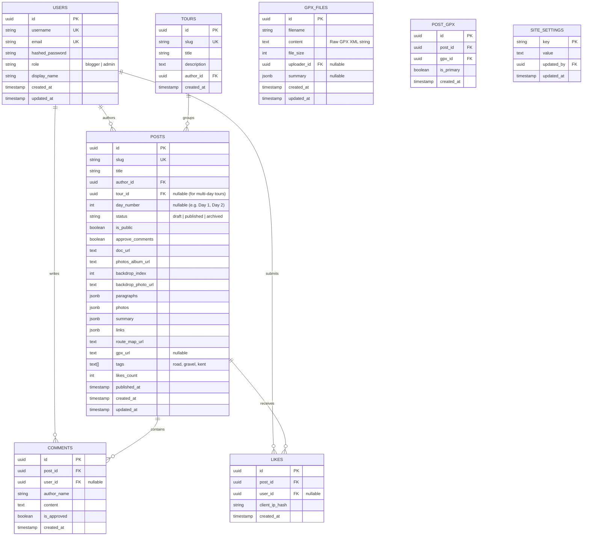

# Cycling Blog Platform - Database & Backend Specification (database2.md)

## 1. System Architecture & Railway Deployment Strategy

The platform operates as a decoupled full-stack architecture hosted on **Railway**:

```
+---------------------------------------------------------------------------------+
|                                 RAILWAY PROJECT                                 |
|                                                                                 |
|  +-----------------------+     REST API / JSON     +-------------------------+  |
|  |   NEXT.JS FRONTEND    | <---------------------> |     FASTAPI BACKEND     |  |
|  |  (Next.js App Router) |                         |  (Python 3.11 / Uvicorn)|  |
|  +-----------------------+                         +-------------------------+  |
|                                                                 |               |
|                                                          SQLAlchemy ORM         |
|                                                          & Alembic              |
|                                                                 v               |
|                                                    +-------------------------+  |
|                                                    |   POSTGRESQL DATABASE   |  |
|                                                    |     (Railway Plugin)    |  |
|                                                    +-------------------------+  |
+---------------------------------------------------------------------------------+
```

### Railway Portability Guarantee
- **PostgreSQL Service**: Uses Railway's managed PostgreSQL plugin. Connection configured via standard `DATABASE_URL` environment variable.
- **FastAPI Service**: Runs with `uvicorn main:app --host 0.0.0.0 --port $PORT`. Auto-detects `DATABASE_URL` and runs Alembic migrations on container startup.
- **Next.js Service**: Communicates with FastAPI via `NEXT_PUBLIC_API_URL`.
- **CORS Setup**: FastAPI CORS middleware configured to allow requests from the Railway frontend domain and `localhost:3000` for development.

---

## 2. User Roles & Permission Matrix (RBAC)

The system supports three user tiers: **Reader**, **Blogger**, and **Admin**.

| Feature / Action | Reader (No Login) | Blogger (Logged In) | Admin (Logged In) |
| :--- | :---: | :---: | :---: |
| Read Public Published Blogs | ✅ | ✅ | ✅ |
| Read Private Blogs | ❌ | ✅ (All blogs) | ✅ (All blogs) |
| View Drafts & Archived Blogs | ❌ | ✅ (Own drafts/archive) | ✅ (All drafts/archive) |
| Like Posts | ✅ (1 per IP/session) | ✅ | ✅ |
| Leave Comments | ✅ (Subject to moderation) | ✅ | ✅ |
| Save Drafts / Publish / Archive | ❌ | ✅ (Own posts) | ✅ (Any post) |
| Toggle Public / Private Switch | ❌ | ✅ (Own posts) | ✅ (Any post) |
| Toggle `approve_comments` Mode | ❌ | ✅ (Own posts) | ✅ (Any post) |
| Approve / Delete Pending Comments | ❌ | ✅ (On own posts) | ✅ (On any post) |
| Change Site Background & Settings | ❌ | ❌ | ✅ |
| Re-sync Google Photos Album URLs | ❌ | ✅ (Own posts) | ✅ (Any post) |
| Manage User Roles / Accounts | ❌ | ❌ | ✅ |

---

## 3. Post Lifecycle & Status Workflow

```
                  +--------------------------------+
                  |             DRAFT              |
                  |  - Only author/admin can see   |
                  |  - Excluded from public feeds  |
                  +--------------------------------+
                               |        ^
                       Publish |        | Revert to Draft
                               v        |
                  +--------------------------------+
                  |           PUBLISHED            |
                  |  - Appears on public feeds     |
                  |  - Can be Public or Private    |
                  |  - Comments & likes enabled    |
                  +--------------------------------+
                               |        ^
                       Archive |        | Unarchive
                               v        |
                  +--------------------------------+
                  |            ARCHIVED            |
                  |  - Excluded from front feed    |
                  |  - Preserved at direct slug    |
                  |  - Comments closed             |
                  +--------------------------------+
```

### Post Status Definitions
1. **`draft`**: Work in progress. Only visible to the author and admins. Excluded from public feeds and search results.
2. **`published`**: Active post with a recorded `published_at` timestamp. Visible to readers if `is_public=true`, or restricted to bloggers if `is_public=false`.
3. **`archived`**: Retired chronicle. Excluded from front-page "Latest" and "Favourites" feeds, but accessible via author profile or direct link. Comments are automatically closed.

---

## 4. Relational Database Schema (PostgreSQL)



### Key Schema Additions

#### 1. `posts` Table Enhancements
| Column | Type | Constraints | Description |
| :--- | :--- | :--- | :--- |
| `status` | `VARCHAR(20)` | NOT NULL, default `'draft'`, INDEX | `'draft'`, `'published'`, or `'archived'` |
| `published_at` | `TIMESTAMPTZ` | Nullable, INDEX | Set when first published (feeds order by this) |
| `archived_at` | `TIMESTAMPTZ` | Nullable | Set when archived |
| `tour_id` | `UUID` | FK (`tours.id`), Nullable | Groups multi-day tours (e.g. Kent Tour Days 1–3) |
| `day_number` | `INT` | Nullable | Day sequence number (e.g. `1` for Day 1) |
| `gpx_url` | `TEXT` | Nullable | Direct download link for route GPX file |
| `tags` | `VARCHAR(50)[]`| default `'{}'` | Categorization tags: `['gravel', 'hills', 'kent']` |
| `is_public` | `BOOLEAN` | default `true` | Public vs blogger-only visibility |
| `approve_comments`| `BOOLEAN` | default `false` | Comment moderation gatekeeper |
| `likes_count` | `INT` | default `0`, INDEX | Cached counter for fast ranking |

#### 2. `tours` Table (Multi-Day Tour Grouping)
| Column | Type | Constraints | Description |
| :--- | :--- | :--- | :--- |
| `id` | `UUID` | Primary Key | Tour identifier |
| `slug` | `VARCHAR(255)`| UNIQUE, NOT NULL | e.g. `kent-autumn-tour-2026` |
| `title` | `VARCHAR(255)`| NOT NULL | e.g. "Kent & Sussex Coast Tour" |
| `description` | `TEXT` | Nullable | Overview of the multi-day journey |
| `author_id` | `UUID` | FK (`users.id`), NOT NULL | Tour creator |
| `created_at` | `TIMESTAMPTZ` | default `NOW()` | Creation date |

#### 3. `gpx_files` Table & `post_gpx` Linking Table
| Table | Column | Type | Constraints | Description |
| :--- | :--- | :--- | :--- | :--- |
| `gpx_files` | `id` | `UUID` | Primary Key | File identifier |
| `gpx_files` | `filename` | `VARCHAR(255)` | NOT NULL | Original filename (e.g. `kent_stage1.gpx`) |
| `gpx_files` | `content` | `TEXT` | NOT NULL | Raw GPX XML text stored directly in database |
| `gpx_files` | `file_size` | `INT` | default `0` | File size in bytes |
| `gpx_files` | `uploader_id` | `UUID` | FK (`users.id`), Nullable | Uploading author |
| `post_gpx` | `id` | `UUID` | Primary Key | Link record identifier |
| `post_gpx` | `post_id` | `UUID` | FK (`posts.id`, CASCADE) | Associated post |
| `post_gpx` | `gpx_id` | `UUID` | FK (`gpx_files.id`, CASCADE) | Associated GPX file |
| `post_gpx` | `is_primary` | `BOOLEAN` | default `true` | Primary route flag |

---

## 5. Front Page Snapshot & Query Specifications

### Snapshot Modes

#### Mode A: "Latest" Snapshots (Published Only)
- **Condition**: `status = 'published'` AND (`is_public = true` OR viewer is blogger/admin).
- **Ordering**: `ORDER BY published_at DESC`.

#### Mode B: "Favourites" Snapshots (Most Liked)
- **Condition**: `status = 'published'` AND (`is_public = true` OR viewer is blogger/admin).
- **Ordering**: `ORDER BY likes_count DESC, published_at DESC`.

#### Mode C: Blogger Drafts & Archive (Private Author Drawer)
- **Condition**: `author_id = :current_user_id` AND `status IN ('draft', 'archived')`.
- **Ordering**: `ORDER BY updated_at DESC`.

#### Mode D: Search by Blogger & Tags
- **Blogger Search**: `u.display_name ILIKE '%' || :search_term || '%'`.
- **Tag Filter**: `:tag = ANY(p.tags)`.

#### Mode E: "Show All" Index
- Tabular overview showing: Title, Tour/Day, Date (`published_at`), Blogger Name, Status badge (`Published`, `Draft`, `Archived`), and Likes count.

---

## 6. Recommended Architectural Enhancements

At this stage, the following features provide significant value for future scalability:

1. **Multi-Day Tour Navigation ("Next / Previous Day")**:
   - Because posts like *"Day 1 Kent Cycling"* link to *"Day 2 to Romney Marsh"*, the `tour_id` + `day_number` relationship allows the reader UI to render automated `← Previous Day` and `Next Day →` navigation pills.

2. **Route GPX Integration**:
   - Storing a `gpx_url` enables readers to download the exact GPX file or render interactive elevation profiles directly on the route map card.

3. **Reader Spam & Bot Protection**:
   - Since readers can comment and like without logging in, implement:
     - **Honeypot form field**: Hidden input that bots fill out, silently discarding bot comments.
     - **IP Hash Deduplication**: Salted SHA-256 hash of IP + User-Agent for likes, ensuring privacy compliance while preventing like spam.
     - **FastAPI Rate Limiting**: Limit anonymous comment submissions to 5 per minute per IP.

4. **Album Link Re-Sync Endpoint (`POST /api/v1/posts/{slug}/resync-photos`)**:
   - Allows authors to click a "Re-sync Album" button if they add new photos to their Google Photos shared album later, updating the 15 streaming URLs dynamically.

5. **Site Settings Key-Value Store**:
   - Managed by admins:
     - `home_backdrop_url`: Site background photo.
     - `site_title` / `site_tagline`: Configurable platform headers.
     - `comments_enabled_globally`: Master kill-switch to temporarily freeze new comments if needed.

---

## 7. Complete FastAPI Endpoint Catalog

### Authentication & Users (`/api/v1/auth`, `/api/v1/users`)
- `POST /auth/login`: Issue JWT token.
- `GET /auth/me`: Current user role & profile.
- `GET /users/bloggers`: List all bloggers for the search dropdown.

### Post Authoring & Lifecycle (`/api/v1/posts`)
- `GET /`: Feed with filters (`status`, `sort=latest|favourites`, `blogger`, `tag`, `tour_id`).
- `GET /{slug}`: Read chronicle (checks public status or author/blogger login).
- `POST /`: Create new post (defaults to `status='draft'`).
- `PUT /{slug}`: Update post content & metadata.
- `DELETE /{slug}`: Delete post.
- `POST /{slug}/publish`: Transition from `draft` to `published` (sets `published_at = NOW()`).
- `POST /{slug}/archive`: Transition to `archived` (sets `archived_at = NOW()`).
- `POST /{slug}/revert-to-draft`: Revert published post back to `draft`.
- `POST /{slug}/resync-photos`: Re-fetch Google Photos shared album to update URLs.

### Reader Interactions (`/api/v1/posts/{slug}/...`)
- `POST /{slug}/like`: Submit a like.
- `GET /{slug}/comments`: List approved comments (plus pending comments if viewer is author/admin).
- `POST /{slug}/comments`: Post comment (auto-queued for approval if `approve_comments=true`).
- `PATCH /comments/{id}/approve`: Approve pending comment (Author or Admin only).
- `DELETE /comments/{id}`: Delete comment (Author or Admin only).

### Multi-Day Tours (`/api/v1/tours`)
- `GET /`: List all cycling tours.
- `GET /{slug}`: Get tour details with ordered list of day chronicles.
- `POST /`: Create tour collection.

### Administration (`/api/v1/admin`)
- `GET /settings`: Get all site settings.
- `PUT /settings/{key}`: Update setting (e.g. `home_backdrop_url`).
- `GET /comments/pending`: Moderation queue across all blogs.
