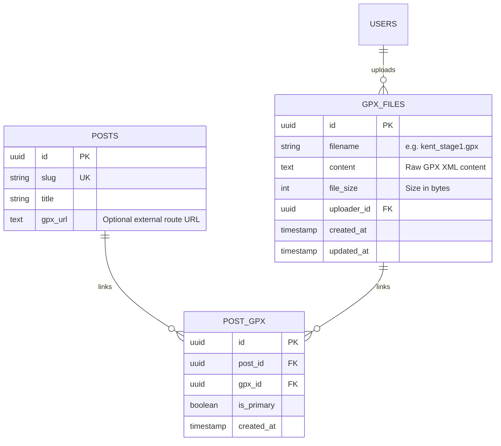

# GPX Route File Architecture: Storage, Linking & Download

## 1. Objective & Scope

The sole purpose of this feature is:
1. **Author Upload**: An author writing or editing a chronicle can upload a `.gpx` file (or paste an external route URL).
2. **Database Storage**: The uploaded GPX file is stored directly in the database (not scattered across temporary filesystem directories).
3. **Reader Download**: Anyone reading the chronicle can click a single button or link to download that exact `.gpx` file for their cycling computer (Garmin, Wahoo, Hammerhead) or view the external route.
4. **Simple & Functional**: No complex metrics widgets, multi-tab dashboards, or elevation charts—just clean upload and download functionality.

---

## 2. Database Architecture

Because GPX files are lightweight XML text files (typically 50 KB – 1.5 MB), storing the raw XML text directly in the database keeps the entire deployment stateless and eliminates local server disk dependencies.

### Entity Relationship Diagram

### Table Definitions

1. **`gpx_files`**:
   - `id`: `UUID` (String 36), Primary Key.
   - `filename`: `VARCHAR(255)`, original filename (e.g. `kent_downs_loop.gpx`).
   - `content`: `TEXT`, the exact raw GPX XML string.
   - `file_size`: `INTEGER`, size in bytes.
   - `uploader_id`: `UUID` foreign key referencing `users.id` (set null on delete).
   - `created_at` / `updated_at`: `DATETIME` timestamps.

2. **`post_gpx` (Linking Table)**:
   - `id`: `UUID` (String 36), Primary Key.
   - `post_id`: `UUID` foreign key referencing `posts.id` (cascade delete).
   - `gpx_id`: `UUID` foreign key referencing `gpx_files.id` (cascade delete).
   - `is_primary`: `BOOLEAN` (default `1`).
   - `created_at`: `DATETIME` timestamp.
   - Unique constraint on `(post_id, gpx_id)`.

3. **`posts.gpx_url` (Coexistence with External Links)**:
   - `posts.gpx_url` remains available so authors who prefer to paste a Strava or Komoot link can still do so.

---

## 3. Database Migration (Alembic)

A dedicated Alembic migration script (`backend/alembic/versions/f28d0beb1746_create_gpx_files_and_post_gpx_tables.py`) has been generated and applied to the database:
- Creates `gpx_files` table.
- Creates `post_gpx` linking table with foreign keys and unique constraints.
- Updates database revision to `head`.

---

## 4. Backend Endpoints

All endpoints are registered under `/api/v1/gpx` in the FastAPI backend:

| Method | Endpoint | Access | Description |
| :--- | :--- | :--- | :--- |
| `POST` | `/api/v1/gpx/upload` | Blogger / Admin | Accepts multipart file (`.gpx`), saves raw XML to `gpx_files`, returns file `id` and `download_url`. |
| `GET` | `/api/v1/gpx/{id}/download` | Public | Streams raw GPX XML directly from database with `Content-Type: application/gpx+xml` and download attachment headers. |
| `DELETE` | `/api/v1/gpx/{id}` | Blogger / Admin | Deletes the GPX record and cascades through `post_gpx`. |

When creating or updating a post via `POST /api/v1/posts` or `PUT /api/v1/posts/{slug}`:
- Supplying `gpx_id` automatically establishes the row in `post_gpx`.
- Posts returned via `GET /api/v1/posts/{slug}` include `gpx_files: [{ id, filename, file_size, download_url }]`.

---

## 5. User Interface (Minimal & Functional)

### In the Editor (`/new`)
A simple, straightforward input section:
- **File Upload**: A standard file picker input (`<input type="file" accept=".gpx">`).
  - Selecting a `.gpx` file uploads it immediately to the database and displays the attached filename with a simple `[✕ Remove]` button.
- **External URL**: A standard text input for authors who prefer to paste an external Strava, Komoot, or GPX URL instead of uploading.
- No heavy panels, elevation diagrams, or multi-tab switchers.

### In the Blog Reader
- If a GPX file is attached in the database, display a clean download button:
  `[ 📥 Download GPX File (kent_route.gpx) ]` linking to `/api/v1/gpx/{id}/download`.
- If an external route URL is provided, display a clean link:
  `[ 🗺️ Open Route Link ]` opening the URL in a new tab.
